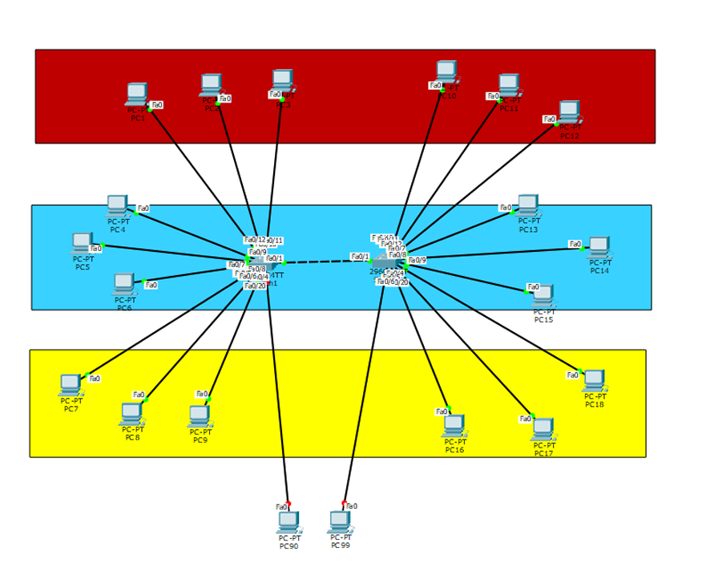

# Segmentación de Red mediante VLANs y Enlaces Troncales (802.1Q)

Implementación de segmentación lógica de capa 2 en Cisco Packet Tracer utilizando dos switches Cisco Catalyst 2960[cite: 2]. El laboratorio establece múltiples VLANs departamentales, enlaces troncales con filtrado explícito de tráfico y aseguramiento básico de puertos no utilizados mediante una VLAN restringida (*blackhole*) y deshabilitación administrativa (`shutdown`)[cite: 2, 4, 5, 9].

---

## Arquitectura y Topología



La infraestructura consta de dos switches **Cisco 2960** interconectados a través de un enlace troncal (`FastEthernet0/1`)[cite: 2, 5]. La red está dividida en cuatro dominios de broadcast[cite: 2]:

* **VLAN 10 (`DepartamentoA`):** Subred `192.168.10.0/24` (3 hosts por switch)[cite: 2, 4].
* **VLAN 20 (`DepartamentoB`):** Subred `192.168.20.0/24` (3 hosts por switch)[cite: 2, 4].
* **VLAN 30 (`DepartamentoC`):** Subred `192.168.30.0/24` (3 hosts por switch)[cite: 2, 4].
* **VLAN 90 (`Intruder`):** VLAN de aislamiento para puertos no utilizados y equipos no autorizados (`192.168.90.0/24`, 1 host por switch)[cite: 2, 3, 4].

---

## Plan de Direccionamiento IP

| Host | Switch | VLAN | Dirección IP | Máscara de Subred |
| :--- | :--- | :--- | :--- | :--- |
| **PC1** | Switch 1[cite: 3] | VLAN 10[cite: 3] | `192.168.10.2`[cite: 3] | `255.255.255.0`[cite: 3] |
| **PC2** | Switch 1[cite: 3] | VLAN 10[cite: 3] | `192.168.10.3`[cite: 3] | `255.255.255.0`[cite: 3] |
| **PC3** | Switch 1[cite: 3] | VLAN 10[cite: 3] | `192.168.10.4`[cite: 3] | `255.255.255.0`[cite: 3] |
| **PC10** | Switch 2[cite: 3] | VLAN 10[cite: 3] | `192.168.10.5`[cite: 3] | `255.255.255.0`[cite: 3] |
| **PC11** | Switch 2[cite: 3] | VLAN 10[cite: 3] | `192.168.10.6`[cite: 3] | `255.255.255.0`[cite: 3] |
| **PC12** | Switch 2[cite: 3] | VLAN 10[cite: 3] | `192.168.10.7`[cite: 3] | `255.255.255.0`[cite: 3] |
| **PC4** | Switch 1[cite: 3] | VLAN 20[cite: 3] | `192.168.20.2`[cite: 3] | `255.255.255.0`[cite: 3] |
| **PC5** | Switch 1[cite: 3] | VLAN 20[cite: 3] | `192.168.20.3`[cite: 3] | `255.255.255.0`[cite: 3] |
| **PC6** | Switch 1[cite: 3] | VLAN 20[cite: 3] | `192.168.20.4`[cite: 3] | `255.255.255.0`[cite: 3] |
| **PC13** | Switch 2[cite: 3] | VLAN 20[cite: 3] | `192.168.20.5`[cite: 3] | `255.255.255.0`[cite: 3] |
| **PC14** | Switch 2[cite: 3] | VLAN 20[cite: 3] | `192.168.20.6`[cite: 3] | `255.255.255.0`[cite: 3] |
| **PC15** | Switch 2[cite: 3] | VLAN 20[cite: 3] | `192.168.20.7`[cite: 3] | `255.255.255.0`[cite: 3] |
| **PC7** | Switch 1[cite: 3] | VLAN 30[cite: 3] | `192.168.30.2`[cite: 3] | `255.255.255.0`[cite: 3] |
| **PC8** | Switch 1[cite: 3] | VLAN 30[cite: 3] | `192.168.30.3`[cite: 3] | `255.255.255.0`[cite: 3] |
| **PC9** | Switch 1[cite: 3] | VLAN 30[cite: 3] | `192.168.30.4`[cite: 3] | `255.255.255.0`[cite: 3] |
| **PC16** | Switch 2[cite: 3] | VLAN 30[cite: 3] | `192.168.30.5`[cite: 3] | `255.255.255.0`[cite: 3] |
| **PC17** | Switch 2[cite: 3] | VLAN 30[cite: 3] | `192.168.30.6`[cite: 3] | `255.255.255.0`[cite: 3] |
| **PC18** | Switch 2[cite: 3] | VLAN 30[cite: 3] | `192.168.30.7`[cite: 3] | `255.255.255.0`[cite: 3] |
| **PC90** | Switch 1[cite: 3] | VLAN 90[cite: 3] | `192.168.90.2`[cite: 3] | `255.255.255.0`[cite: 3] |
| **PC99** | Switch 2[cite: 3] | VLAN 90[cite: 3] | `192.168.90.3`[cite: 3] | `255.255.255.0`[cite: 3] |

---

## Implementación y Verificación en Cisco IOS

### 1. Asignación de VLANs y Puertos

Se crearon las VLANs de datos (`10`, `20`, `30`) y la VLAN de aislamiento (`90`)[cite: 4]. Todos los puertos sin uso (`Fa0/13` a `Fa0/24` y `Gig0/1` a `Gig0/2`) fueron asignados a la VLAN 90 como medida de mitigación contra accesos físicos no autorizados[cite: 4].

```ios
Switch#show vlan brief

VLAN Name                             Status    Ports
---- -------------------------------- --------- -------------------------------
1    default                          active    
10   DepartamentoA                    active    Fa0/2, Fa0/3, Fa0/10, Fa0/11
                                                Fa0/12
20   DepartamentoB                    active    Fa0/7, Fa0/8, Fa0/9
30   DepartamentoC                    active    Fa0/4, Fa0/5, Fa0/6
90   Intruder                         active    Fa0/13, Fa0/14, Fa0/15, Fa0/16
                                                Fa0/17, Fa0/18, Fa0/19, Fa0/20
                                                Fa0/21, Fa0/22, Fa0/23, Fa0/24
                                                Gig0/1, Gig0/2
1002 fddi-default                     active    
1003 token-ring-default               active    
1004 fddinet-default                  active    
1005 trnet-default                    active